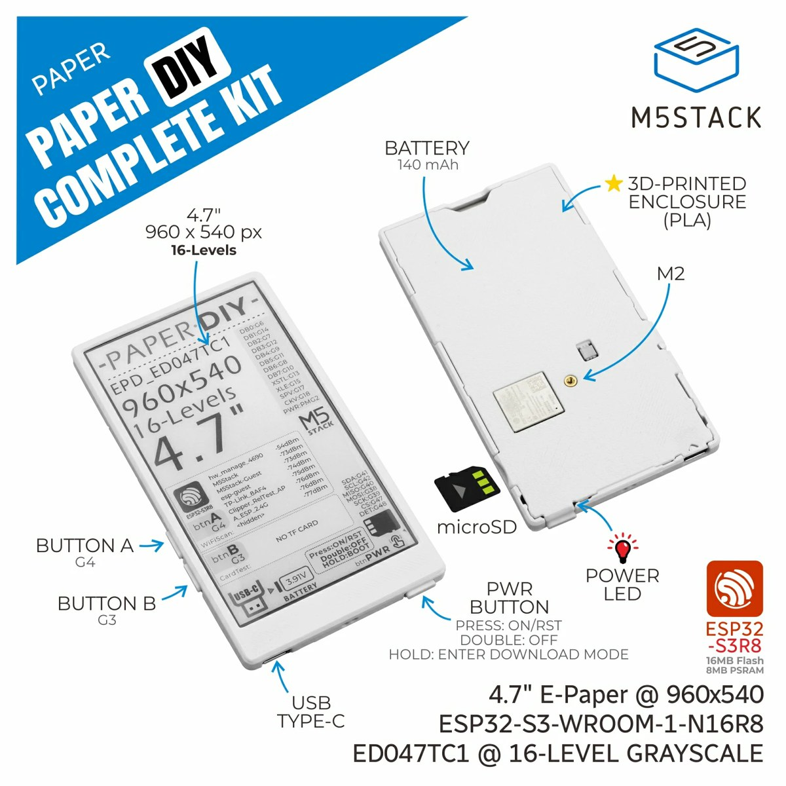

# InkSight × M5Stack PaperDIY 快速上手（本机已部署 + 真机已验证）

> 设备：**M5Stack PaperDIY Complete Kit（SKU K159-B）** — ESP32-S3R8（16MB Flash + 8MB OPI PSRAM），
> 4.7" **ET047TC1 960×540** 16 灰墨水屏，**M5PM1** 电源管理，2 个用户按键，140mAh 电池，USB-C。
>
> 本机：macOS，仓库 `~/Documents/deepseek-harness/default-workspace/inksight`（下称「仓库根目录」）。
>
> 本文是「照着做就能用」的上手说明；部署运维细节见 [`deploy-local.md`](deploy-local.md)，
> 固件构建/刷机/恢复细节见 [`../firmware/FLASH_M5PAPERDIY.md`](../firmware/FLASH_M5PAPERDIY.md)。

---

## 0. 当前状态

| 项目 | 状态 |
|------|------|
| 设备 | ✅ 已刷入 InkSight 固件并真机跑通（MAC `B8:1F:3F:B8:54:2C`） |
| 后端 FastAPI | ✅ `http://127.0.0.1:8080`（局域网 `http://192.168.3.6:8080`） |
| WebApp Next.js | ✅ `http://127.0.0.1:3000`（局域网 `http://192.168.3.6:3000`） |
| 设备 WiFi | ✅ `HUAWEI-1G76Z9`，设备 IP `192.168.3.5`，信号 -42 dBm |
| 电池 | ✅ 4.10 V（M5PM1 BAT_ADC 读取正常） |
| 屏幕 | ✅ 960×540 横屏、1-bit 黑白方向/极性正确，已显示天气卡片 |
| 本地账号 | 设备已绑定账号 **`chen`**，初始密码 **`qxhpMZxrsG2e`**（登录后可改） |
| LLM Key | ❌ 未配置：WEATHER/MEMO 等正常；CALENDAR/DAILY 等含 LLM 步骤的模式会走降级文案 |

> ⚠️ **两个端口别搞混**
> - **前端 WebApp**（你在电脑/手机浏览器里打开的配置页）：`http://192.168.3.6:3000`
> - **设备要填的“服务器地址”**（后端 API，配网页里那个输入框）：`http://192.168.3.6:8080`
>
> 设备配网时如果填成 3000，设备会连不上后端（表现为一直显示配对码或旧图）。

服务管理：

```bash
cd ~/Documents/deepseek-harness/default-workspace/inksight
backend/scripts/local-servers.sh status     # 端口/健康检查/局域网地址
backend/scripts/local-servers.sh restart    # 改后端代码或 .env 后
backend/scripts/local-servers.sh rebuild    # 改 webapp 代码后
backend/scripts/local-servers.sh stop|start
backend/scripts/local-servers.sh logs       # 同时 tail 两个日志
backend/scripts/device-status.sh            # 设备最近渲染/模式/刷新间隔/健康状态速查
```

日志：`backend/logs/backend.log`、`webapp/logs/webapp.log`。

---

## 1. 刷固件（已经刷好了，换板/重刷时再看）

固件环境：`firmware/platformio.ini` → **`epd_47_m5paperdiy_s3`**
（espressif32@8.0.0 / arduino-esp32 3.3.12、qio_opi + OPI PSRAM、16MB OTA 分区、
M5GFX 0.2.33 + M5Unified 0.2.26、USB CDC 日志）。

现成镜像：

- 合并镜像（刷 0x0）：`firmware/dist/paperdiy/inksight-firmware-paperdiy_s3-0.1.0-paperdiy.bin`
  （1,965,360 B，sha256 `313d16b6…97b2`）
- WebFlasher 同源地址：`http://192.168.3.6:3000/firmware/inksight-paperdiy-s3.bin`
- 工厂固件完整备份（16MB）：`firmware/backups/paperdiy-factory-full.bin`
  （sha256 `c1aef31c…1ea3`，可随时恢复）

### 进下载模式

用 **USB-C 数据线**连电脑（必须能传数据），**长按底部电源键约 2 秒**，直到背面右下角
**红灯闪烁**再松手 —— 此时进入下载模式。macOS 上端口是 `/dev/cu.usbmodem*`（本次为
`/dev/cu.usbmodemB81F3FB8542C1`）。

### 方式 A（推荐）：命令行 esptool

```bash
cd ~/Documents/deepseek-harness/default-workspace/inksight/firmware
ls /dev/cu.usbmodem*        # 确认端口

../.tooling/venv/bin/esptool --chip esp32s3 --port /dev/cu.usbmodemXXXX --baud 921600 \
  write-flash -z --flash-mode dio --flash-freq 80m --flash-size 16MB \
  0x0 dist/paperdiy/inksight-firmware-paperdiy_s3-0.1.0-paperdiy.bin
```

刷完按一下电源键（单击=开机/复位）即可启动。

> ⚠️ 用 esptool 刷完后，芯片经常**停在 ROM 下载模式**（USB 口还在，但屏幕不动、串口无日志）：
> 软件复位（esptool `--after hard_reset`）对这块板子无效，必须**物理按键冷启动**：
> 双击电源键关机 → 再单击开机（或单击一次电源键复位）。判断方法：应用模式 USB 端口名带 MAC
> （如 `/dev/cu.usbmodemB81F3FB8542C1`），ROM 下载模式是 `/dev/cu.usbmodem101` 且无串口输出。

### 方式 B：浏览器 WebFlasher（Chrome / Edge）

打开 `http://192.168.3.6:3000/zh/flash` → 选「手动 URL」→ 填
`http://192.168.3.6:3000/firmware/inksight-paperdiy-s3.bin` → 刷写 → 选串口。

### 恢复出厂固件（需要时）

```bash
cd ~/Documents/deepseek-harness/default-workspace/inksight/firmware
../.tooling/venv/bin/esptool --chip esp32s3 --port /dev/cu.usbmodemXXXX --baud 921600 \
  write-flash -z --flash-mode dio --flash-freq 80m --flash-size 16MB \
  0x0 backups/paperdiy-factory-full.bin
```

> PaperDIY 的 **OTA 已在固件里禁用**：官方 InkSight 发布的是 4.2" 400×300 固件，
> 刷进来点不亮这块 960×540 屏。升级只能 USB 重刷。

---

## 2. 配网（已经配好；换 WiFi / 换 IP 时看这里）

1. 设备没有 WiFi 配置时，开机会自动进入配网模式，屏幕上出现 **SETUP WIFI** 画面
   （满屏刷新需要几秒，属正常）。
2. 手机上连接热点 **`InkSight-542C`**（后 5 位是设备 MAC 尾号；本次设备是 `542C`）。
3. 浏览器打开 **http://192.168.4.1**（手机提示“无互联网/登录网络”时选**保持连接**）。
4. 填：
   - 家里 **2.4GHz** WiFi 的 SSID + 密码（设备不支持 5GHz；SSID 有中文/空格时容易出错）；
   - **服务器地址 = `http://192.168.3.6:8080`**（注意是 8080，不是 3000，末尾不要 `/`）。
5. 保存 → 屏幕显示 **配网完成** → 15 秒后自动重启连网 → 拉取并显示内容。

### 配网超时 / 连不上怎么办

- 配网热点有 **10 分钟**超时，超时后设备进入深睡，热点消失。**按一下电源键或任意用户键唤醒**，
  重新进入配网模式再配一次。
- 报“连接超时，请重试”= 设备连不上你填的 WiFi：优先检查 **2.4GHz**、密码、SSID 拼写；
  路由器隐藏 SSID / WPA3 也可能导致失败。
- 想强制清空配置（保留固件）：擦 NVS 分区
  `../.tooling/venv/bin/esptool --chip esp32s3 --port /dev/cu.usbmodemXXXX erase-region 0x9000 0x4000`
  （esptool v4 用 `erase_region`），然后重新配网。

### 换 Mac IP / 后端换地址

- 建议在路由器给这台 Mac 做 **DHCP 静态保留**。
- 如果 IP 变了：设备连续 3 个刷新周期连不上后端后会自动开热点，手机连上改服务器地址即可
  （不用 USB）；也可以长按 **ButtonA**（GPIO4）约 2 秒在设备醒着时直接进配网模式。

---

## 3. 日常使用

- **WebApp 配置页**：`http://192.168.3.6:3000` → 登录 `chen` / `qxhpMZxrsG2e`
  → 「设备配置」→ 选模式、屏幕尺寸（已设为 **4.7" 960×540**）、刷新间隔、城市等。
- **按键位置**（官方产品图：横放时在屏幕**左侧边框**，下面是 Button B、上面是 Button A；电源键在**右下边框**）：

  

- **按键**（PaperDIY 有两个用户键，均已真机验证）：
  - **ButtonA = GPIO4**：深睡时按下 → 唤醒并刷新（已验证）；醒着时长按约 2 秒 → 进配网模式
    （屏幕出现 SETUP WIFI，已验证）；开机时按住 → 强制配网。
  - **ButtonB = GPIO3**：长按约 3 秒 → 进入 AI 对话流程（本板无音频 codec，显示提示后自动退出，
    已验证）；后续可改成别的功能。
  - 配网热点名一般是 `InkSight-` + MAC 后 4 位（本机是 `InkSight-542C`）。极端情况下串口日志
    可能打印 `InkSight-0000`（已知小显示问题，不影响实际热点名/连接）。
- **刷新/睡眠**：默认每 60 分钟唤醒刷新一次；首次安装/刚配网后会保持在线 10 分钟方便调试。
- **电池**：140mAh，屏幕全刷一次 + WiFi 会消耗较多，建议刷新间隔 ≥ 60 分钟。

### 加 DeepSeek Key（启用 AI 类模式）

```bash
cd ~/Documents/deepseek-harness/default-workspace/inksight
# 编辑 backend/.env：DEEPSEEK_API_KEY=sk-xxxx
backend/scripts/local-servers.sh restart
```

或在 WebApp「个人信息」页按账号填。没 Key 时建议只用 `WEATHER` / `MEMO` / `TIMETABLE` 等
不依赖 LLM 的模式（当前配置里的 `CALENDAR`/`DAILY` 含 LLM 步骤，会走降级文案）。

---

## 4. 真机已验证（2026-10-20 晚）

串口日志（USB CDC 115200）关键行：

```
=== InkSight ===
[EPD] PaperDIY init: board=34 display=960x540 rotation=1 psram=7088544
[WAKE] Power on or reset
WiFi: HUAWEI-1G76Z9 .... OK  IP=192.168.3.5
[TOKEN] HTTP code: 200 / [PAIR] HTTP code: 200 / [HEARTBEAT] POST -> 200
[BAT] PaperDIY vbat=4.10V
GET http://192.168.3.6:8080/api/render?v=4.10&mac=B8:1F:3F:B8:54:2C&rssi=-42&refresh_min=60&w=960&h=540&bpp=1&colors=2
HTTP code: 200 / Content-Length: 64862 / BMP OK 64800 bytes
Displaying image... smartDisplay: full refresh (cycle 0) / Display done
```

`board=34` 即 `board_M5PaperDIY`（M5GFX 自动识别成功）；屏幕实际显示天气卡片
（方向/黑白/排版正常）。固件构建、镜像头/分区表、C3 4.2" 与 PaperS3 环境回归均已通过。

**深睡唤醒已验证**：23:37:56 进入深睡（60 分钟定时 + ButtonA/GPIO4 唤醒），
23:45 按 Button A 后设备唤醒并在 23:45:17 重新拉图（后端记录 CALENDAR，RSSI -50）——说明
M5PM1 保持 3V3 供电、GPIO 深睡唤醒、唤醒后重新联网拉图整条链路正常。

**按键也已验证**：ButtonA 长按 2 秒进配网（屏幕 SETUP WIFI，串口
`Config button held for 2000ms, entering portal...`）；ButtonB 长按 3 秒进入 AI 对话流程
（无音频 → 提示后自动退出，串口 `[AI CHAT] Switch held for 3000ms`）；配网恢复后
23:51:25 重新拉图（DAILY）并正常进入 60 分钟深睡。

**尚未验证**：深睡实际电流、电池电压精度长期表现、无人值守长时间稳定性、
恢复工厂固件的流程（备份已在，未实测恢复）。

---

## 5. 本机部署与改动清单

- **部署**：后端 `backend/.venv`（Python 3.11）+ WebApp（Next.js）；一键脚本
  `backend/scripts/local-servers.sh`；日志/端口见 §0。
- **固件**：新增 `epd_47_m5paperdiy_s3` 环境 + `BOARD_PROFILE_M5PAPERDIY`；
  `firmware/src/epd_driver.cpp` 的 47" 分支用 M5GFX `Panel_EPD` 驱动并行总线；
  电源/电池走 M5Unified（M5PM1）；按键 GPIO4/GPIO3 启用；OTA 禁用；
  `firmware/FLASH_M5PAPERDIY.md` + `scripts/`（构建/收集/刷机/校验）。
  PaperS3 环境 `epd_47_m5papers3_s3` 仍然保留可用。
- **后端**：960×540 字号缩放、MEMO 布局修复、设备预置脚本、服务管理脚本、`INKSIGHT_BILLING_ENABLED=0`。
- **WebApp**：4.7" 尺寸选项、局域网 IP 访问白名单、WebFlasher 本地 `.bin` 代理、
  `public/firmware/inksight-paperdiy-s3.bin`。
- **文档**：本文、[`deploy-local.md`](deploy-local.md)、[`../firmware/FLASH_M5PAPERDIY.md`](../firmware/FLASH_M5PAPERDIY.md)、
  [`../firmware/FLASH_M5PAPERS3.md`](../firmware/FLASH_M5PAPERS3.md)。
